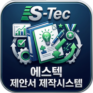

# S-Tec Proposal Production System (에스텍 제안서 제작시스템)



**에스텍 그룹 제안서 제작시스템** · v1.0.0 · 통합관리 시스템 9번째 프로그램 (`stpp`)

견적 프로그램 3종에서 만든 견적을 그대로 불러와 **업종·산업별 제안서(Word)** 와 **발표자료(PPT·PDF)** 를 만듭니다.

**🔍 RFP 분석 → 🧭 기획 → ✍ 집필 → ✅ 검토·승인 → 🖨 제작·제본 → 📤 제출**

## 내려받기

| 구분 | 주소 |
|---|---|
| 웹 버전 | https://sadness500-boop.github.io/S-Tec-Proposal-Production-System/ |
| 파일 하나로 여는 배포본 | `releases/S-Tec-Proposal-Production-System_v2.0.0.html` |
| 안드로이드 앱 (최신) | https://github.com/sadness500-boop/S-Tec-Proposal-Production-System/releases/download/app-latest/stpp-latest.apk |

- **APK는 GitHub Actions가 만듭니다.** `index.html`·`version.json`을 올리면 Actions 「Android APK」가 약 5분 뒤 `releases/`와 릴리스에 APK를 올립니다.
- **웹 주소를 열려면** 저장소 Settings › Pages › Branch를 `main` / `/(root)`로 한 번 켜야 합니다.

## 견적 연동 (3개 프로그램)

| 견적 프로그램 | 연동 내용 |
|---|---|
| S-Tec-Quotation-System (용역인력 견적) | 직종·직책·인원·근무형태·1인 월 단가·월 도급비·부가세·계약기간 총액·원가 구성·부대비용 |
| Workload-Based Cost and Labor Estimation Method (업무량 기반 산정) | 업무량(월 시간)·FTE·편성안·인원·월 금액·**업무별 비용 배분표** |
| S-Tec short estimate (단기인력 견적) | 행사·단기 항목별 인원·근무시간·일수·금액·공급가액·부가세 |

1. 각 견적 프로그램 화면 오른쪽 아래 **「📑 제안서로 보내기」** (↗ 버튼은 보내고 제안서 제작시스템 열기)
2. 이 기기(`stec_proposal_inbox`)와 **통합 로그인 서버(같은 계정)** 에 함께 저장 → 다른 기기에서도 보입니다.
3. 제안서 제작시스템 「① 견적 연동」에서 체크 → 여러 견적(예: 보안 + 업무량 기반 미화 + 행사 단기) 합산 가능
- 「보내기」 전 자료도 각 프로그램의 **견적 보관함**을 직접 읽어 인원 구성은 보여 줍니다(금액은 「보내기」 후 확정).
- 연동 파일(.json) 불러오기·내보내기, 견적 프로그램 없이 **직접 입력**도 됩니다.
- 연동 스크립트 원본: `bridge/stec-proposal-link.js` (3개 견적 프로그램 `index.html`에 들어 있음, 계산 방식은 바꾸지 않음)

## 주요 기능

- **상단 기능** (통합관리 시스템과 동일): 제안 담당 · 다운로드 QR · 친구추천 · 내 계정(통합 로그인·관리자 페이지) · 주간/야간/시스템
- **메인 화면**: 통합관리 시스템 메인 화면 디자인(유리 효과 상단 바 · 디오라마 히어로 · 둥근 카드) 기반, 사진 1(제안서 제작 디오라마)을 히어로에, 사진 2를 좌측 상단·앱 아이콘에 사용
- **RFP 분석**: 제안요청서·과업지시서(PDF·Word·HWPX·메일·사진 글자 인식)를 읽어 요구사항을 14개 구분으로 나누고 대응 목차를 연결한 **요구사항 대응표** 작성, 사업명·발주처·기간·인원·예산·업종·직종 추정
- **기획**: 업종 12종(제조·물류·병원·오피스·공공·대학·아파트·상업·호텔·건설·발전항만·외국공관) × 직종 9종(보안·미화·주차·시설·안내·조리·방역·경호·기타), 제안 유형 6종, 평가 강조점 8종, 차별화 포인트 10종
- **집필 (13개 목차)**: 제안 개요 · 회사 소개 · 현황 분석 및 요구사항 · 운영 전략 및 차별화 · 인력 운영 계획 · 업무 수행 방안 · 교육·훈련 · 안전보건·법규 준수 · 품질관리·Complaint 대응 · 스마트 운영관리 체계(9개 프로그램) · 운영 개시·인수인계 · 가격 제안 · 기대효과 — 목차별 편집·끄기
- **검토·승인**: 작성 → 검토 요청 → 승인 → 제출 완료, 8개 검토 체크리스트(견적 금액 일치·요율 연도·법정 교육·RFP 대응·고객사 명칭·회사 수치 검증·개인정보·오탈자), 결재란(작성·검토·승인)
- **제작·제본**: Word 제안서(표지·목차·요약·표·붙임 견적 상세·내부용 결재 기록, 회사 머리글·바닥글 서명) · PPT 16:9 발표자료 · PDF
- **대외 제출용 / 내부 검토용**: 내부용에만 원가 구성·결재 기록이 들어갑니다.
- **🏢 회사 정보**: 회사 소개·실적·인증을 편집 (수치는 내부 자료로 확인한 값만 기재)
- 제안서 저장·불러오기(제출 이력), 로그인 시 여러 기기 동기화

## 기본 베이스

- 통합관리 시스템 8개 프로그램 구성(근태관리·사업장 현황 지도·용역인력 견적·업무량 기반 산정·단기인력 견적·고객 불만처리·업무표준화·매뉴얼·법률 대응) — 상단 기능·통합 로그인·권한·출력 엔진·사업장 151곳 목록
- Claude 프로젝트: [S-Tec Job](현장 운영·Complaint 대응 원칙) · [Legal standards](경비업법·근로기준법·파견법 등) · [Manual - Project](직종×산업 매뉴얼 4계층) · [Marketing](통합마케팅·견적 원가) · [AI creation program](프로그램 그룹) · 에스텍베스트 회사소개서

## 통합 로그인 · 권한 (Supabase)

- `auth-config.json`이 통합관리 시스템·8개 프로그램과 **같은 Supabase 서버**를 가리킵니다 — 하나의 아이디.
- **처음 한 번:** Supabase → SQL Editor → [`server/supabase_app_access_stpp.sql`](server/supabase_app_access_stpp.sql) 실행 (프로그램 등록부에 `stpp` 등록 → 메인 화면 카드 · 「🔐 프로그램별 권한」에서 사용자별 지정). 제작자·관리자는 바로 사용.
  - 또는 통합관리 시스템 관리 콘솔 「🧩 프로그램 등록」에서 code `stpp`로 등록해도 됩니다.
- 견적 연동 자료는 기존 동기화 표(`user_data`)의 `stec_proposal_inbox` 항목을 씁니다(새 표 불필요). 제안서는 `stec_pp_projects`·`stec_pp_ui`·`stec_pp_company`로 동기화됩니다.

## 파일 구성

```
index.html                       프로그램 전체 (한 파일, 라이브러리 내장)
source/                          원본: kb.js(업종·직종·법령·목차) · link.js(견적 연동) · rfp.js(RFP 분석) · ui.js · app.js(집필) · engine.js · out.js(Word·PPT·PDF) · build.py
bridge/stec-proposal-link.js     견적 3종 「📑 제안서로 보내기」 연동 스크립트
server/                          Supabase SQL (stpp 등록 · 프로그램별 권한)
lib/                             PDF 읽기(pdf.js) · 글자 인식(tesseract.js)
icons/ · assets/ · manifest.webmanifest · sw.js   앱 아이콘 · 디오라마 · 홈 화면 설치(PWA)
.github/workflows/android-apk.yml               안드로이드 앱 자동 빌드
```
빌드: `python3 source/build.py`

## 변경 이력

- **v2.0.0** (2026-11-19): 제안서 전면 재구성
  - 발표자료(PPT·PDF): 5 PART 구성 50~60장 — 표지·오프닝 메시지·인사말·목차·요약 → 에스텍 소개(핵심 지표·연혁·사업 영역·운영 네트워크 지도·경쟁력 비교·통합관리 시스템) → 현황 분석(2026 트렌드·현장 이해·포지셔닝·진단·RFP 대응표) → 운영 제안(비전·특화서비스·조직·인력·POST 배치도·근무 편성표·시간대별 운영·직종별 업무·하루 일과·현장 영상·교육·연간 교육 계획·안전보건 PDCA·비상 대응·법령·KPI·Complaint·스마트 운영·일정) → 가격 제안(금액·원가 구성·업무별 비용) → 에스텍의 약속(기대효과·SLA·클로징)
  - 사진 42장·현장 영상 프레임 30장·영상 30편(`media/`) 활용 — PPT에는 영상이 직접 들어가 재생, PDF·Word에는 장면 사진으로 표시
  - Word 제안서: 표지 사진·인사말·PART 표지·직종별 사진·하루 일과표·연간 교육 계획표·비상 대응표·SLA·그림(도해) 수록
  - 회사 정보에 「연혁」「핵심 지표」 입력란 추가 (수치는 출처·기준일과 함께 확인 후 사용)
- **v1.0.0** (2026-11-19): 최초 버전

---
※ 법령 요약은 국가법령정보센터(law.go.kr) 기준 실무 참고용입니다. 회사 수치·실적은 내부 자료로 확인 후 기재하십시오.

Designed & Developed by **Rat Rae Choi**
